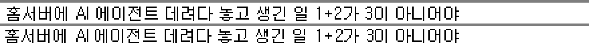

# Gulim Pixel

[](https://github.com/byongshintv/gulim-pixel/blob/main/OFL.txt) [](https://www.jsdelivr.com/package/gh/byongshintv/gulim-pixel)

굴림 9pt(12px) 비트맵을 점 단위 그대로 옮긴 웹폰트.



원본 굴림 TTF 안에 들어 있는 12px 전용 비트맵의 점 하나를 정사각형 하나로 바꿔 외곽선 폰트로 다시 만들었습니다. 12px에서 원본 비트맵과 점 단위로 같고, 브라우저·OS와 상관없이 똑같이 보입니다. 굵게는 윈도우식 1px 덧찍기입니다.

사용 예: [blog.banipest.com](https://blog.banipest.com/)

## 지원 범위

| 범위 | Gulim Pixel | Gulim Pixel Bold |
|------|-------------|------------------|
| 기본 라틴·라틴-1 | ✓ | ✓ |
| 한글 음절 | ✓ (11,172자 전체) | ✓ |
| 한글 호환 자모 | ✓ | ✓ |
| 히라가나·가타카나 | ✓ | ✓ |
| 한자 (CJK 통합 한자) | ✓[^hanja] | ✓[^hanja] |
| CJK 호환 한자 | ✓[^ks] | ✓[^ks] |

[^hanja]: 원본 굴림 12px 비트맵에 있는 7,476자.
[^ks]: KS X 1001의 268자.

## 웹폰트로 쓰기

### HTML

```html
<link rel="stylesheet" href="https://cdn.jsdelivr.net/gh/byongshintv/gulim-pixel@1/dist/gulim-pixel.css">
```

### CSS

```css
@import url('https://cdn.jsdelivr.net/gh/byongshintv/gulim-pixel@1/dist/gulim-pixel.css');
```

### 패밀리 지정

```css
font-family: 'Gulim Pixel', sans-serif;
font-size: 12px; /* 또는 24px, 36px 같은 12의 정수배 */
-webkit-font-smoothing: none;
```

13px·15px 같은 어중간한 크기에서는 도트가 깨집니다.

## 데스크톱 설치

[`fonts/ttf`](fonts/ttf)의 TTF 파일을 받아 설치하면 됩니다. 마찬가지로 12px(9pt)과 그 정수배에서만 도트가 맞습니다.

## 직접 빌드

```bash
pip install fonttools brotli
python3 scripts/build-gulim-pixel.py
```

[googlefonts/gulim](https://github.com/googlefonts/gulim)의 원본 소스 TTF(`sources/ttf/Gulim.ttf`)를 받아 `fonts/woff2`에 다시 만듭니다. 구글이 빌드해 둔 배포본에는 12px 한글 조합에 필요한 숨은 자모 조각이 빠져 있어 원본 소스를 씁니다.

----

<details>
<summary>라이선스</summary>

원본 굴림은 한양정보통신의 글꼴로, [googlefonts/gulim](https://github.com/googlefonts/gulim)에 SIL Open Font License 1.1로 공개되어 있습니다. Gulim Pixel은 그 12px 비트맵에서 만든 파생 폰트이며 같은 [OFL 1.1](OFL.txt)을 따릅니다. 개인·상업 용도 모두 무료로 쓸 수 있고, 폰트 파일만 따로 판매하는 것은 금지됩니다.

빌드 코드는 AI(Claude)가 작성했습니다.
</details>
